






  
Hi there! I’m Yuhan! I am currently a Postdoctoral Research Fellow at the Computer Science Department of MBZUAI, working with <a href="https://www.cs.mcgill.ca/~xueliu/">Prof. Steve (Xue) Liu</a> (IEEE Fellow, Fellow of the Canadian Academy of Engineering, ACM Distinguished Member) and <a href="https://jiank2.github.io/">Prof. Jian Kang</a>. Along the way, my work has been recognized by prestigious honors, including being selected as a <a href="https://www.daad.de/en/the-daad/postdocnet/fellows/fellows/#LiuYuhan">DAAD AInet Fellow (2025)</a> by the <a href="https://www.daad.de/en/">German Academic Exchange Service (DAAD)</a>. I am also a visiting researcher with the multimodal group at the Technical University of Munich under the DAAD Fellowship, working with <a href="https://www.eml-munich.de/people/zeynep-akata">Prof. Zeynep Akata</a>. I also collaborate with <a href="https://researchers.mgh.harvard.edu/profile/4211743/Quanzheng-Li">Prof. Quanzheng Li</a> and <a href="https://wuyichen-97.github.io/">Dr. Yichen Wu</a> at Harvard Medical School on VLM- and agent-based methods for medicine. I received my Ph.D. in Artificial Intelligence from <a href="http://ai.ruc.edu.cn">Gaoling School of Artificial Intelligence</a>, Renmin University of China (2021-2025). Prior to RUC, I earned my M.S. in Mathematics and B.S. in Automation from China University of Petroleum (Beijing).

<strong>I am on the job market, actively seeking faculty positions.</strong> Feel free to reach out at <a href="mailto:liuyuhaning@gmail.com">liuyuhaning@gmail.com</a>.

## ❤️ Research Interests
{: #research}

I aim to <strong class="research-aim">build AI agents that make the digital world more trustworthy by understanding, verifying, and reasoning within it.</strong> Today's foundation models generate, spread, and judge information at massive scale, yet are trained on static snapshots of a world where information is constantly distorted and contested through social interaction. <strong>Consensus ≠ Truth.</strong> We work on <u><strong>Simulation, Reasoning, and Perception</strong></u> at the intersection of <u><strong>Language, Vision, and Science</strong></u>, to equip foundation-model agents with an internal model of the high-stakes world they act in. Recently, we have been especially interested in LLM-agent simulation of how misinformation emerges, evolves, and spreads (<a href="https://aclanthology.org/2025.emnlp-main.1330/">FUSE</a>, <a href="https://arxiv.org/abs/2403.09498">FPS</a>), multi-agent collaboration for accurate and accountable decision-making (<a href="https://arxiv.org/abs/2602.09159">CoMMa</a>), and trustworthy agentic reasoning across language and vision (<a href="https://arxiv.org/abs/2601.22628">TTCS</a>, <a href="https://aclanthology.org/2026.acl-long.517/">Laser</a>).

  

    
<u><strong>Simulation</strong></u>: Generative Agents as a Scientific Instrument (Language + Science). &rarr; show/hide work on LLM-agent societies as controlled experiments on how falsehood emerges and spreads.

    <ul>
      <li>Misinformation dynamics: <a href="https://arxiv.org/abs/2403.09498">FPS</a> for attitude evolution, <a href="https://aclanthology.org/2025.emnlp-main.1330/">FUSE</a> for stepwise news distortion, <a href="https://www.vldb.org/2025/Workshops/VLDB-Workshops-2025/DATAI/DATAI25_9.pdf">SoAgent</a> for conspiracy diffusion.</li>
      <li>Platform and market dynamics: <a href="https://arxiv.org/abs/2505.16429">RecInter</a> for recommender simulation, <a href="https://arxiv.org/abs/2411.01143">TIS</a> and <a href="https://dl.acm.org/doi/10.1145/3726302.3730334">SAGraph</a> for influencer simulation.</li>
      <li>Community: <a href="https://liuyuhan31.github.io/MisinformationAgent/">Tutorial on Misinformation and LLM Agents</a> (AAAI 2027), <a href="https://sciagentverse.github.io">SciAgentVerse workshop</a> (WSDM 2027).</li>
    </ul>
  

  

    
<u><strong>Reasoning</strong></u>: Collective and Self-Evolving (Multi-Agent Collaboration, Test-Time Learning). &rarr; show/hide work on agents that reason collectively and keep improving from their own experience.

    <ul>
      <li>Truth beyond consensus: <a href="https://arxiv.org/abs/2603.06801">AceMAD</a> for escaping the Martingale Curse, <a href="https://arxiv.org/abs/2505.08532">TruEDebate</a> for debate-based fake news detection.</li>
      <li>Accountable aggregation: <a href="https://arxiv.org/abs/2602.09159">CoMMa</a> for contribution-aware credit assignment.</li>
      <li>Self-synthesized curricula: <a href="https://arxiv.org/abs/2601.22628">TTCS</a>, <a href="https://arxiv.org/abs/2505.16401">Divide-Fuse-Conquer</a>, <a href="https://aclanthology.org/2026.findings-acl.968/">WriterAgent</a>.</li>
      <li>Learning from exploration and demonstrations: <a href="https://aclanthology.org/2025.findings-acl.1195.pdf">ThinkCoder</a>, <a href="https://aclanthology.org/2025.acl-long.1475/">DrICL</a>, <a href="https://aclanthology.org/2024.lrec-main.749/">IAD</a>.</li>
    </ul>
  

  

    
<u><strong>Perception</strong></u>: Grounded in Evidence. &rarr; show/hide work on multimodal models that answer from evidence and verify AI-generated content.

    <ul>
      <li>Faithful multimodal perception: <a href="https://arxiv.org/abs/2504.20199">Focus-Centric Visual Chains</a>, <a href="https://arxiv.org/abs/2510.24285">ViPER</a>, <a href="https://aclanthology.org/2026.acl-long.517/">Laser</a>, <a href="https://aclanthology.org/2026.findings-acl.733/">Temporal Contrastive Decoding</a>.</li>
      <li>Verifying multimodal misinformation: <a href="https://arxiv.org/abs/2603.14992">MAGIC3</a> for short-video fake news, <a href="https://aclanthology.org/2026.findings-acl.1613/">AI-Generated Video Detection Survey</a>.</li>
      <li>Grounding in structured knowledge: <a href="https://doi.org/10.1145/3589334.3645565">Geometry-Unified KGE with Optimal Transport</a>.</li>
    </ul>
  

  

    
<u><strong>Applications</strong></u>: Trustworthy Agents in High-Stakes Domains. &rarr; show/hide work on deploying these capabilities where trust matters most.

    <ul>
      <li>Healthcare: <a href="https://arxiv.org/abs/2602.09159">CoMMa</a> for multi-agent oncology decision support with Harvard Medical School.</li>
      <li>Recommendation and digital advertising: <a href="https://arxiv.org/abs/2505.16429">RecInter</a>, <a href="https://dl.acm.org/doi/10.1145/3726302.3730334">SAGraph</a>, <a href="https://arxiv.org/abs/2411.01143">TIS</a>.</li>
      <li>Scientific communication and domain knowledge: <a href="https://aclanthology.org/2026.findings-acl.952/">GlossaGen</a>, <a href="https://arxiv.org/abs/2502.10708">Knowledge Injection Survey</a>.</li>
      <li>Creative writing and code: <a href="https://aclanthology.org/2026.findings-acl.968/">WriterAgent</a>, <a href="https://aclanthology.org/2025.findings-acl.1195.pdf">ThinkCoder</a>.</li>
    </ul>
  

<i class="fas fa-envelope" aria-hidden="true"></i> Prospective collaborators: If you’re interested in my research interests and would like to collaborate, feel free to <a href="mailto:yuhan.liu@mbzuai.ac.ae">contact me</a>.

## 🔥 News
{: #news}

<ul>
<li>2026.10 🎉🎉 Our tutorial <a href="https://liuyuhan31.github.io/MisinformationAgent/">Misinformation in the Age of LLM Agents: Generation, Propagation, and Intervention</a> is accepted at <strong>AAAI 2027</strong> (Montréal, Canada)! Xiuying, Preslav, Xiangliang, and I look forward to meeting you there!</li>
<li>2026.10 🎉🎉 Our workshop proposal <a href="https://sciagentverse.github.io">The First Workshop on Scientific Agents in the Digital World (SciAgentVerse)</a> is accepted at <strong>WSDM 2027</strong> (Hong Kong, China)! Looking forward to meeting you there!</li>
<li>2026.09 🎉🎉 Two papers are accepted by <strong>NeurIPS 2026</strong> (Sydney, Australia)! <a href="https://arxiv.org/abs/2602.09159">CoMMa</a> (Spotlight, Top 0.69%) and <a href="https://arxiv.org/abs/2601.22628">TTCS</a>.</li>
<li>2026.04 🎉🎉 Six papers are accepted by <strong>ACL 2026</strong> (San Diego, USA)!</li>
<li>2026.01 🎉🎉 One paper is accepted by <strong>ICLR 2026</strong> (Rio de Janeiro, Brazil)! Celebrating this with my good friend Juntian! 🥳🥳</li>
<li>2025.11 🎉🎉 I was awarded a <strong>DAAD fellowship</strong>!</li>
<li>2025.10 🎉 Invited to serve as an Area Chair for ACL.</li>
<li>2025.08 🎉🎉 Three papers are accepted by <strong>EMNLP 2025</strong> (Suzhou, China)!</li>
<li>2025.08 🥳🥳🎉🎉 I joined <strong>MBZUAI</strong> as a Postdoctoral Research Fellow in Machine Learning.</li>
<li>2025.07 ✈️ Attending <strong>ACL 2025</strong> in Vienna—looking forward to connecting!</li>
<li>2025.05 🥳🥳🎉🎉🥳🥳🎉🎉 I have successfully defended my <strong>PhD thesis</strong>!</li>
<li>2025.05 🎉🎉 Three papers are accepted by <strong>ACL 2025</strong> (Vienna, Austria)!</li>
<li>2025.05 🎉🎉 Two papers are accepted by <strong>SIGIR 2025</strong> (Padua, Italy)!</li>
<li>2024.12 🎉🎉 We won the <strong>Gold Medal</strong> in the Tencent Multi-Agent Application Competition (Rank 1/210)! Congratulations to my friend Xuyan!</li>
<li>2024.08 ✈️ Attending <strong>IJCAI 2024</strong> in South Korea—looking forward to connecting!</li>
<li>2024.07 🎉 Invited to serve as a Session Chair for IJCAI 2024 NLP Track (Jeju, South Korea).</li>
<li>2024.05 🎉🎉 One paper is accepted by <strong>IJCAI 2024</strong> (Oral) (Jeju, South Korea)!</li>
<li>2024.05 ✈️ Attending <strong>COLING 2024</strong> in Italy—looking forward to connecting!</li>
<li>2024.05 ✈️ Attending <strong>WWW 2024</strong> in Singapore—looking forward to connecting!</li>
<li>2024.02 🎉🎉 One paper is accepted by <strong>COLING 2024</strong> (Turin, Italy)!</li>
<li>2024.02 🎉 Selected as a delegate for the RUC-Yale "Artificial Intelligence, Emerging Technologies" International Forum.</li>
<li>2024.01 🎉🎉 One paper is accepted by <strong>The Web Conference 2024</strong> (Singapore)!</li>
</ul>

## 📝 Publications
{: #publications}

<code>*</code> indicates Co-first Author, <code>#</code> indicates Corresponding Author

  
<a class="image-popup" href="/images/publications/comma-full.webp" title="CoMMa: Contribution-Aware Medical Multi-Agents for Decentralized Oncology Decision Support">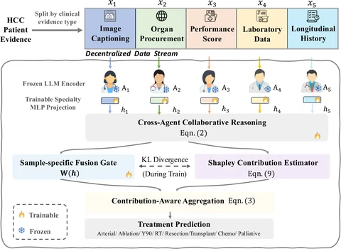</a>

  

    
CoMMa: Contribution-Aware Medical Multi-Agents for Decentralized Oncology Decision Support

    
Yichen Wu*, Kailong Fan*, Sangjoon Park*, <strong><u>Yuhan Liu</u></strong>, Zhiyi Shi, Sekeun Kim, Dania Daye, Hana Farzaneh, Xiang Li, Raul Uppot, Yujin Oh, Quanzheng Li

    
<em>Conference on Neural Information Processing Systems</em> (<strong>NeurIPS</strong>), 2026. (Spotlight, Top 0.69%)

    
[<a href="https://arxiv.org/abs/2602.09159">📄 Paper</a>]

  

  
<a class="image-popup" href="/images/publications/ttcs-full.webp" title="TTCS: Test-Time Curriculum Synthesis for Self-Evolving">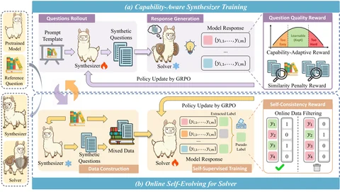</a>

  

    
TTCS: Test-Time Curriculum Synthesis for Self-Evolving

    
Chengyi Yang, Zhishang Xiang, Yunbo Tang, Zongpei Teng, Chengsong Huang, Fei Long, <strong>Yuhan Liu#</strong>, Jinsong Su

    
<em>Conference on Neural Information Processing Systems</em> (<strong>NeurIPS</strong>), 2026.

    
[<a href="https://arxiv.org/abs/2601.22628">📄 Paper</a>] [<a href="https://github.com/XMUDeepLIT/TTCS">💻 Code</a>] [<a href="https://mp.weixin.qq.com/s/Vp4E2-hORs5UQ1v2bpa0Gg">📰 机器之心 (Synced)</a>] [<a href="https://x.com/jiqizhixin/status/2024189925411663977">🐦 Twitter</a>]

  

  
<a class="image-popup" href="/images/publications/forest-full.webp" title="Forest Before Trees: Latent Superposition for Efficient Visual Reasoning">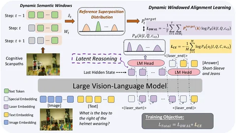</a>

  

    
Forest Before Trees: Latent Superposition for Efficient Visual Reasoning

    
Yubo Wang*, Juntian Zhang*, Yichen Wu, Yankai Lin, Nils Lukas, <strong>Yuhan Liu#</strong>

    
<em>Annual Meeting of the Association for Computational Linguistics</em> (<strong>ACL</strong>), 2026.

    
[<a href="https://aclanthology.org/2026.acl-long.517/">📄 Paper</a>] [<a href="https://github.com/ybb6/laser">💻 Code</a>] [<a href="https://mp.weixin.qq.com/s/BdisI0FZqLqEwyWnIQhzuQ">📰 机器之心 (Synced)</a>] [<a href="https://x.com/jiqizhixin/status/2055310234227503308">🐦 Twitter</a>]

  

  
<a class="image-popup" href="/images/publications/aivideo-full.webp" title="Detecting AI-Generated Video: A Vision-Language Dual-View Survey">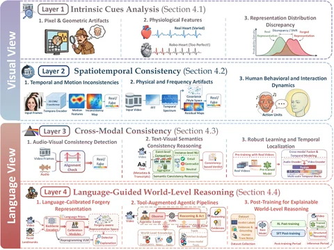</a>

  

    
Detecting AI-Generated Video: A Vision-Language Dual-View Survey

    
Dylan Xinming Hou, Juntian Zhang, Xu Gu, Yichen Wu, Nils Lukas, Gus Xia, Xiuying Chen, <strong>Yuhan Liu#</strong>

    
<em>Findings of the Association for Computational Linguistics</em> (<strong>ACL Findings</strong>), 2026.

    
[<a href="https://aclanthology.org/2026.findings-acl.1613/">📄 Paper</a>] [<a href="https://github.com/dxhou/AI-Generated-Video-Detection">💻 GitHub</a>] [<a href="https://aigcvdetection.github.io/">🏠 Homepage</a>] [<a href="https://mp.weixin.qq.com/s/4B0QbkCJUJa2koS-rTR0gw">📰 新智元 (AI Era)</a>]

  

  
<a class="image-popup" href="/images/publications/style2story-full.webp" title="From Style to Story: A Curriculum Learning Approach for Imitative Novel Generation">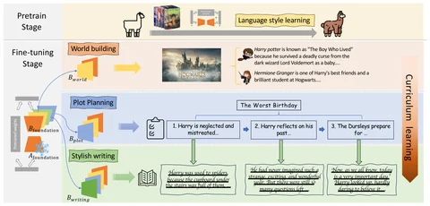</a>

  

    
From Style to Story: A Curriculum Learning Approach for Imitative Novel Generation

    
Xueran Han, <strong><u>Yuhan Liu</u></strong>, Mingzhe Li, Wei Liu, Sen Hu, Rui Yan, Zhiqiang Xu, Xiuying Chen

    
<em>Findings of the Association for Computational Linguistics</em> (<strong>ACL Findings</strong>), 2026.

    
[<a href="https://aclanthology.org/2026.findings-acl.968/">📄 Paper</a>]

  

  
<a class="image-popup" href="/images/publications/tcd-full.webp" title="Temporal Contrastive Decoding: A Training-Free Method for Large Audio-Language Models">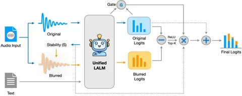</a>

  

    
Temporal Contrastive Decoding: A Training-Free Method for Large Audio-Language Models

    
Yanda Li, <strong><u>Yuhan Liu</u></strong>, Zirui Song, Yunchao Wei, Martin Takáč, Salem Lahlou

    
<em>Findings of the Association for Computational Linguistics</em> (<strong>ACL Findings</strong>), 2026.

    
[<a href="https://aclanthology.org/2026.findings-acl.733/">📄 Paper</a>]

  

  
<a class="image-popup" href="/images/publications/dfc-full.webp" title="Divide-Fuse-Conquer: A Progressive Reinforcement Learning Strategy for Stabilizing LLMs across Diverse Games">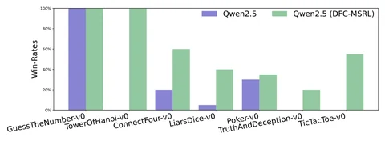</a>

  

    
Divide-Fuse-Conquer: A Progressive Reinforcement Learning Strategy for Stabilizing LLMs across Diverse Games

    
Xiaoqing Zhang, Ang Lv, <strong><u>Yuhan Liu</u></strong>, Zirui Song, Xiuying Chen, Rui Yan, Flood Sung

    
<em>Findings of the Association for Computational Linguistics</em> (<strong>ACL Findings</strong>), 2026.

    
[<a href="https://arxiv.org/abs/2505.16401">📄 Paper</a>]

  

  
<a class="image-popup" href="/images/publications/glossagen-full.webp" title="GlossaGen: Making Academic Translation Smarter with Glossing">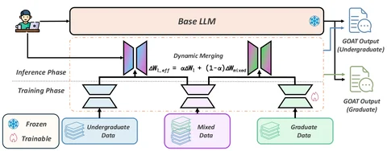</a>

  

    
GlossaGen: Making Academic Translation Smarter with Glossing

    
Zixiao Wang, Duzhen Zhang, Juntian Zhang, <strong><u>Yuhan Liu</u></strong>, Guoming Li, Haolun Wu, Le Song, Xiuying Chen

    
<em>Findings of the Association for Computational Linguistics</em> (<strong>ACL Findings</strong>), 2026.

    
[<a href="https://aclanthology.org/2026.findings-acl.952/">📄 Paper</a>]

  

  
<a class="image-popup" href="/images/publications/viper-full.webp" title="ViPER: Empowering the Self-Evolution of Visual Perception Abilities in Vision-Language Models">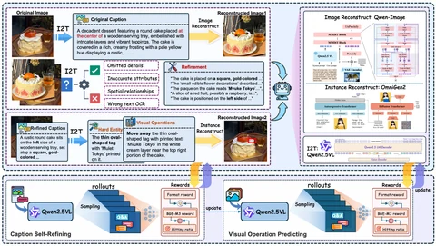</a>

  

    
ViPER: Empowering the Self-Evolution of Visual Perception Abilities in Vision-Language Models

    
Juntian Zhang, Song Jin, Chuanqi Cheng, <strong><u>Yuhan Liu</u></strong>, Yankai Lin, Xun Zhang, Yufei Zhang, Fei Jiang, Guojun Yin, Wei Lin, Rui Yan

    
<em>International Conference on Learning Representations</em> (<strong>ICLR</strong>), 2026.

    
[<a href="https://openreview.net/forum?id=uxea0QCT0e">📄 Paper</a>] [<a href="https://github.com/Icarus1216/ViPER">💻 Code</a>]

  

  
<a class="image-popup" href="/images/publications/stepwise-full.webp" title="The Stepwise Deception: Simulating the Evolution from True News to Fake News with LLM Agents">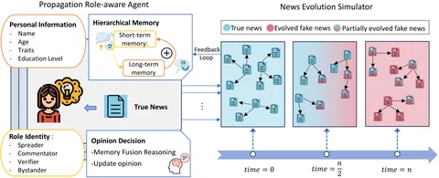</a>

  

    
The Stepwise Deception: Simulating the Evolution from True News to Fake News with LLM Agents

    
<strong>Yuhan Liu</strong>, Zirui Song, Juntian Zhang, Xiaoqing Zhang, Xiuying Chen, Rui Yan

    
<em>Conference on Empirical Methods in Natural Language Processing</em> (<strong>EMNLP</strong>), 2025. (Oral)

    
[<a href="https://aclanthology.org/2025.emnlp-main.1330/">📄 Paper</a>] [<a href="https://github.com/LiuYuHan31/FUSE">💻 Code</a>]

  

  
<a class="image-popup" href="/images/publications/debate-full.webp" title="The Truth Becomes Clearer Through Debate! Multi-Agent Systems with Large Language Models Unmask Fake News">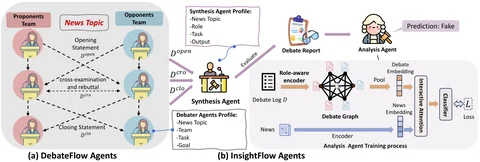</a>

  

    
The Truth Becomes Clearer Through Debate! Multi-Agent Systems with Large Language Models Unmask Fake News

    
<strong>Yuhan Liu</strong>, Yuxuan Liu, Xiaoqing Zhang, Xiuying Chen, Rui Yan

    
<em>International ACM SIGIR Conference on Research and Development in Information Retrieval</em> (<strong>SIGIR</strong>), 2025. (Oral)

    
[<a href="https://arxiv.org/abs/2505.08532">📄 Paper</a>]

  

  
<a class="image-popup" href="/images/publications/injecting-full.webp" title="Injecting Domain-Specific Knowledge into Large Language Models: A Comprehensive Survey">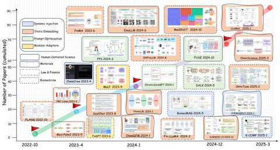</a>

  

    
Injecting Domain-Specific Knowledge into Large Language Models: A Comprehensive Survey

    
Zirui Song*, Bin Yan*, <strong><u>Yuhan Liu</u></strong>, Miao Fang, Mingzhe Li, Rui Yan, Xiuying Chen

    
<em>Conference on Empirical Methods in Natural Language Processing</em> (<strong>EMNLP</strong>), 2025.

    
[<a href="https://arxiv.org/abs/2502.10708">📄 Paper</a>] [<a href="https://github.com/abilliyb/Knowledge_Injection_Survey_Papers">💻 GitHub</a>]

  

  
<a class="image-popup" href="/images/publications/recagent-full.webp" title="Beyond Static Testbeds: An Interaction-Centric Agent Simulation Platform for Dynamic Recommender Systems">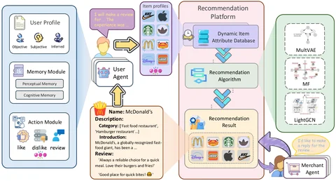</a>

  

    
Beyond Static Testbeds: An Interaction-Centric Agent Simulation Platform for Dynamic Recommender Systems

    
Song Jin*, Juntian Zhang*, <strong>Yuhan Liu#</strong>, Xun Zhang, Yufei Zhang, Guojun Yin, Fei Jiang, Wei Lin, Rui Yan

    
<em>Conference on Empirical Methods in Natural Language Processing</em> (<strong>EMNLP</strong>), 2025.

    
[<a href="https://arxiv.org/abs/2505.16429">📄 Paper</a>] [<a href="https://github.com/jinsong8/RecInter">💻 Code</a>]

  

  
<a class="image-popup" href="/images/publications/weaving-full.webp" title="Weaving Context Across Images: Improving Vision-Language Models through Focus-Centric Visual Chains">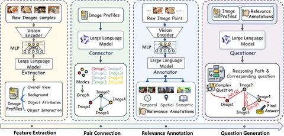</a>

  

    
Weaving Context Across Images: Improving Vision-Language Models through Focus-Centric Visual Chains

    
Juntian Zhang, Chuanqi Cheng, <strong>Yuhan Liu#</strong>, Wei Liu, Jian Luan, Rui Yan

    
<em>Annual Meeting of the Association for Computational Linguistics</em> (<strong>ACL</strong>), 2025.

    
[<a href="https://arxiv.org/abs/2504.20199">📄 Paper</a>]

  

  
<a class="image-popup" href="/images/publications/thinking-full.webp" title="Thinking Before Running! Efficient Code Generation with Thorough Exploration and Optimal Refinement">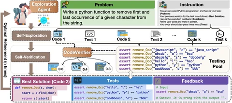</a>

  

    
Thinking Before Running! Efficient Code Generation with Thorough Exploration and Optimal Refinement

    
Xiaoqing Zhang, <strong>Yuhan Liu#</strong>, Flood Sung, Xiuying Chen, Rui Yan

    
<em>Findings of the Association for Computational Linguistics</em> (<strong>ACL Findings</strong>), 2025.

    
[<a href="https://aclanthology.org/2025.findings-acl.1195.pdf">📄 Paper</a>] [<a href="https://github.com/xiaoqzhwhu/ThinkCoder">💻 Code</a>]

  

  
<a class="image-popup" href="/images/publications/moreshot-full.webp" title="More is not always better? Enhancing Many-Shot In-Context Learning with Differentiated and Reweighting Objectives">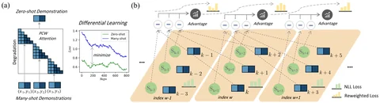</a>

  

    
More is not always better? Enhancing Many-Shot In-Context Learning with Differentiated and Reweighting Objectives

    
Xiaoqing Zhang, Ang Lv, <strong><u>Yuhan Liu</u></strong>, Xiuying Chen, Rui Yan

    
<em>Annual Meeting of the Association for Computational Linguistics</em> (<strong>ACL</strong>), 2025.

    
[<a href="https://aclanthology.org/2025.acl-long.1475/">📄 Paper</a>] [<a href="https://github.com/xiaoqzhwhu/DrICL">💻 Code</a>]

  

  
<a class="image-popup" href="/images/publications/sagraph-full.webp" title="SAGraph: A Large-Scale Social Graph Dataset with Comprehensive Context for Influencer Selection in Marketing">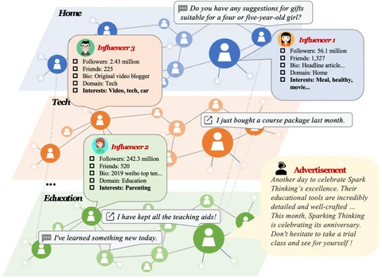</a>

  

    
SAGraph: A Large-Scale Social Graph Dataset with Comprehensive Context for Influencer Selection in Marketing

    
Xiaoqing Zhang, <strong><u>Yuhan Liu</u></strong>, Jianzhou Wang, Zhenxing Hu, Xiuying Chen, Rui Yan

    
<em>International ACM SIGIR Conference on Research and Development in Information Retrieval</em> (<strong>SIGIR</strong>), 2025. (Oral)

    
[<a href="https://dl.acm.org/doi/10.1145/3726302.3730334">📄 Paper</a>] [<a href="https://github.com/xiaoqzhwhu/SAGraph">💻 Code</a>]

  

  
<a class="image-popup" href="/images/publications/soagent-full.webp" title="SoAgent: A Real-world Data Empowered Agent Pool to Facilitate LLM-Driven Generative Social Simulation">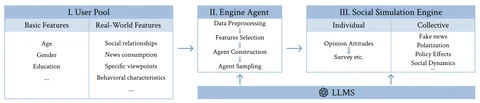</a>

  

    
SoAgent: A Real-world Data Empowered Agent Pool to Facilitate LLM-Driven Generative Social Simulation

    
Na Ta, Kaiyu Li, Yushu Zhou, <strong><u>Yuhan Liu</u></strong>

    
<em>VLDB Workshop on Data-driven AI</em> (<strong>VLDB DATAI</strong>), 2025.

    
[<a href="https://www.vldb.org/2025/Workshops/VLDB-Workshops-2025/DATAI/DATAI25_9.pdf">📄 Paper</a>] [<a href="https://osf.io/nwcmu/?view_only=14b04a52f28141dca07de16bd354e9e4">💻 Code</a>]

  

  
<a class="image-popup" href="/images/publications/skepticism-full.webp" title="From Skepticism to Acceptance: Simulating the Attitude Dynamics Toward Fake News">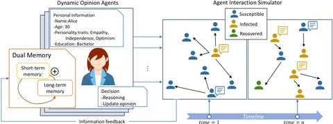</a>

  

    
From Skepticism to Acceptance: Simulating the Attitude Dynamics Toward Fake News

    
<strong>Yuhan Liu</strong>, Xiuying Chen, Xiaoqing Zhang, Xing Gao, Ji Zhang, Rui Yan

    
<em>International Joint Conference on Artificial Intelligence</em> (<strong>IJCAI</strong>), 2024. (Oral, Human-Centred AI Track, 4% acceptance rate)

    
[<a href="https://arxiv.org/abs/2403.09498">📄 Paper</a>] [<a href="https://github.com/LiuYuHan31/FPS">💻 Code</a>]

  

  
<a class="image-popup" href="/images/publications/iad-full.webp" title="IAD: In-Context Learning Ability Decoupler of Large Language Models in Meta-Training">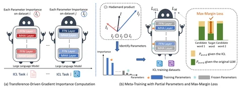</a>

  

    
IAD: In-Context Learning Ability Decoupler of Large Language Models in Meta-Training

    
<strong>Yuhan Liu</strong>, Xiuying Chen, Xing Gao, Ji Zhang, Rui Yan

    
<em>International Conference on Computational Linguistics</em> (<strong>COLING</strong>), 2024.

    
[<a href="https://aclanthology.org/2024.lrec-main.749/">📄 Paper</a>]

  

  
<a class="image-popup" href="/images/publications/spacegap-full.webp" title="Bridging the Space Gap: Unifying Geometry Knowledge Graph Embedding with Optimal Transport">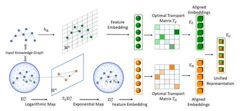</a>

  

    
Bridging the Space Gap: Unifying Geometry Knowledge Graph Embedding with Optimal Transport

    
<strong>Yuhan Liu</strong>, Zelin Cao, Xing Gao, Ji Zhang, Rui Yan

    
<em>The ACM Web Conference</em> (<strong>WWW</strong>), 2024.

    
[<a href="https://doi.org/10.1145/3589334.3645565">📄 Paper</a>]

  

  
<a class="image-popup" href="/images/publications/ccl-full.webp" title="Unleashing the power of large models: Exploring human-machine conversations">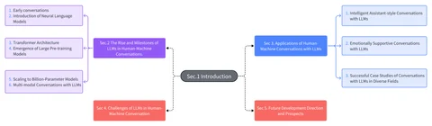</a>

  

    
Unleashing the power of large models: Exploring human-machine conversations

    
<strong>Yuhan Liu</strong>, Xiuying Chen, Rui Yan

    
<em>China National Conference on Computational Linguistics</em> (<strong>CCL</strong>), 2023. (Oral)

    
[<a href="https://aclanthology.org/2023.ccl-2.2/">📄 Paper</a>]

  

  
<a class="image-popup" href="/images/publications/timeaware-full.webp" title="A large-scale time-aware agents simulation for influencer selection in digital advertising campaigns">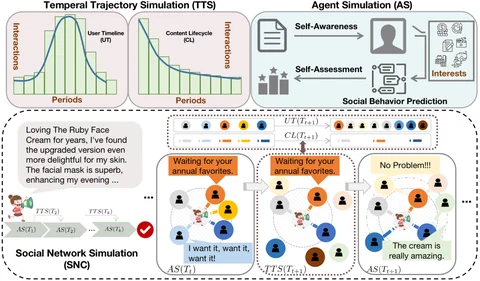</a>

  

    
A large-scale time-aware agents simulation for influencer selection in digital advertising campaigns

    
Xiaoqing Zhang, <strong><u>Yuhan Liu</u></strong>, Jianzhou Wang, Zhenxing Hu, Xiuying Chen, Rui Yan

    
<em>arXiv preprint</em>, 2024.

    
[<a href="https://arxiv.org/abs/2411.01143">📄 Paper</a>]

  

## 🏅 Honors and Awards
{: #awards}
- **2026** &mdash; ICML Golden Reviewer Award
- **2025** &mdash; DAAD AInet Fellowship, Germany
- **2024** &mdash; "Qiushi Academic-Dongliang" Academic Project Funding, RUC
- **2022, 2023, 2024** &mdash; Merit Student, RUC
- **2017, 2020, 2025** &mdash; Outstanding Graduate, Beijing
- **2019-2020** &mdash; National Scholarship

## ⭐ Academic Services
{: #services}

- **Session Chair**: IJCAI 2024 NLP Track (Jeju, Republic of Korea)
- **Area Chair**: ACL, EMNLP
- **Reviewer**: ACL, EMNLP, ICLR, ICML, NeurIPS, SIGIR, WWW, ACM MM, ECAI
- **Program Committee**: AAAI, IJCAI
- **Journal Reviewer**: *Nature Human Behaviour*, *IEEE Transactions on Artificial Intelligence*, *Information Sciences*, *Financial Innovation*

## 💬 Invited Talks
{: #talks}

- **2026.04** &mdash; When Truth Fakes Itself: A Multi-Agent Modeling Approach to Fake News Detection, Propagation, and Evolution Simulation, Natural Language Processing Department, MBZUAI
- **2025.05** &mdash; True Yet False: Large Language Model-based Multi-Agent Systems for Enhanced Security, Xiamen University
- **2025.04** &mdash; Large Language Model-Based Multi-Agent System for Fake News, School of Journalism and Communication, Renmin University of China
- **2024.08** &mdash; From Skepticism to Acceptance: Simulating the Attitude Dynamics Toward Fake News, Microsoft Research Asia

## 🎓 Mentoring Students
{: #students}

- **Dawei Gao** (Ph.D. @ University of North Texas) &mdash; SAGE (Under Review)
- **Yubo Wang** (M.S. @ Fudan University) &mdash; [Forest Before Trees](https://aclanthology.org/2026.acl-long.517/) (ACL 2026 Main Conference)
- **Dylan Xinming Hou** (M.S. @ MBZUAI) &mdash; [Detecting AI-Generated Video](https://aclanthology.org/2026.findings-acl.1613/) (ACL Findings 2026)
- **Abdalla Alzaabi** (M.S. @ MBZUAI) &mdash; Weak-to-Strong Verification in the Internet of Agents (Master's Thesis)
- **Chengyi Yang** (M.S. @ Xiamen University) &mdash; [TTCS](https://arxiv.org/abs/2601.22628) (NeurIPS 2026)
- **Zongpei Teng** (B.S. @ Xiamen University) &mdash; [TTCS](https://arxiv.org/abs/2601.22628) (NeurIPS 2026)
- **Peien Ding** (B.S. @ Xiamen University) &mdash; [LAMB](https://arxiv.org/abs/2610.26955) (Under Review)

## 💻 Experience
{: #experience}

- **2024.11 - 2025.06** &mdash; Meituan, Beijing
- **2022.09 - 2024.11** &mdash; Alibaba DAMO Academy, Beijing
- **2020.07 - 2021.08** &mdash; Xiaomi Tech, Beijing
- **2019.06 - 2019.09** &mdash; Sinovation Ventures, Beijing
- **2019.03 - 2019.06** &mdash; Lenovo Corporate Research, Beijing
- **2018.05 - 2018.09** &mdash; Tencent WeChat, Beijing

## 📖 Teaching Assistant
{: #teaching}

- **2024 Spring, 2022 Spring** &mdash; Natural Language Processing
- **2019 Fall** &mdash; Applied Statistical Methods
- **2019 Spring** &mdash; Optimization Algorithms
- **2019 Fall, 2017 Fall** &mdash; Stochastic Processes
- **2018 Fall** &mdash; Advanced Algebra
- **2018 Spring** &mdash; Advanced Mathematics

## 😃 Best Friends
{: #friends}

Thanks to my best friends! Your help and encouragement are my greatest motivation, and I look forward to creating a better future with all of you!

- <a href="https://iriscxy.github.io/">Xiuying Chen</a> &mdash; Assistant Professor at MBZUAI
- <a href="https://wuyichen-97.github.io/">Yichen Wu</a> &mdash; Postdoctoral Fellow at Harvard University
- <a href="https://scholar.google.com/citations?user=K-6vOfkAAAAJ&hl=zh-CN">Juntian Zhang</a> &mdash; Master's student at Renmin University of China and interning at Tencent WeChat
- <a href="https://trestad.github.io/">Ang Lv</a> &mdash; Ph.D. Candidate at Renmin University of China and interning at ByteDance Top Seed
- <a href="https://www.linkedin.com/in/bowen-li-5a3610344/">Bowen Li</a> &mdash; Ph.D. and incoming postdoc at Tsinghua University and visiting the University of Twente
